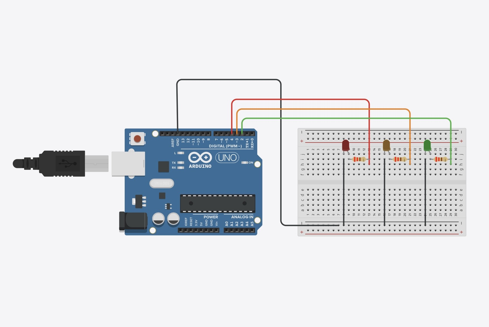

# 🚦 Arduino Traffic Light System

> Interactive simulation and C++ source code of a micro-controller-managed intersection designed on Tinkercad.

## 📌 Circuit Overview

🔗 **Test the live simulation:** [(https://www.tinkercad.com/things/7POaFMM3SUN-feu-tricolore/editel?returnTo=https%3A%2F%2Fwww.tinkercad.com%2Fdashboard%2Fdesigns%2Fall)]

## ⚙️ Features
- Sequential management of traffic lights (Red, Yellow, Green).
- Clean timing cycle implementation for each state.
- Structured C/C++ source code for the ATmega328P microcontroller (Arduino Uno).

## 🛠️ Components Used
- 1x Arduino Uno
- 3x LEDs (Red, Yellow, Green)
- 3x 220Ω Resistors
- Breadboard and jumper wires

## 📂 Repository Structure
- `main.ino` : The main C++ source code for the Arduino.
- `tinkercard-traffic-light.png` : Screenshot of the Tinkercad wiring diagram.
